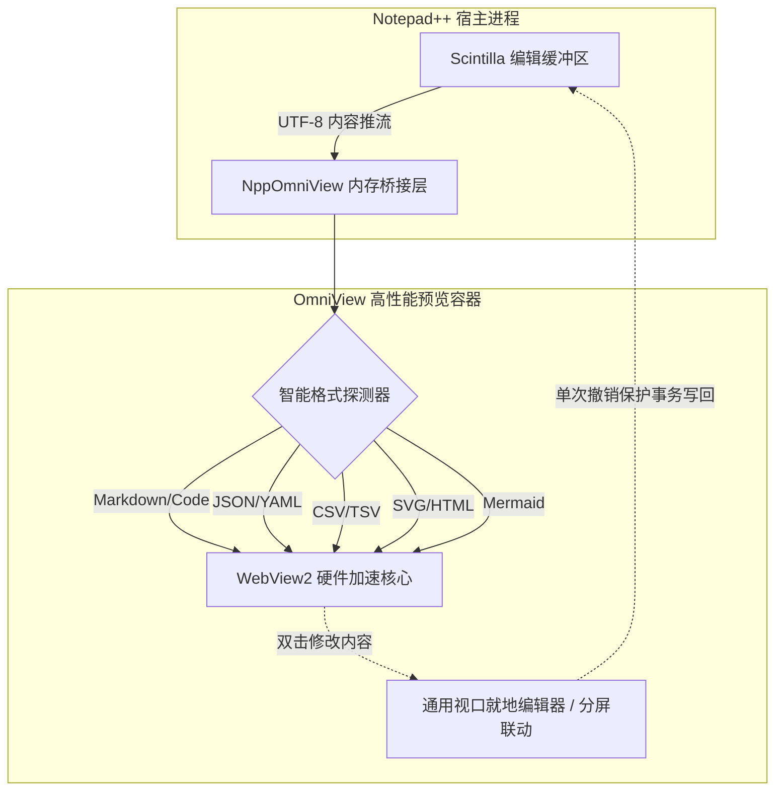
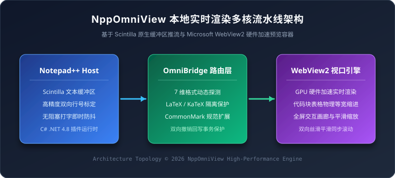
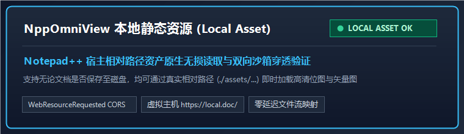

# NppOmniView 极客全功能 Markdown 预览评测套件

> [!NOTE]
> 本文档是专为 **NppOmniView** 打造的深度全特性测试套件，全面覆盖 GFM 语法、全语言专属代码块、KaTeX 数学公式、交互式任务列表、Mermaid 流程图与时序图，以及丰富的文本与表格排版。

> [!TIP]
> **实时双向编辑提示**：
> - 支持双向实时就地编辑：点击顶栏编辑按钮或双击内容区域直接修改，60 FPS 流式渲染，修改即时自动安全保存回写 Notepad++（支持 `Ctrl+Z` 撤销）。
> - 下方的**待办任务列表复选框**支持直接点击打勾/取消，即点即存！

---

## 目录索引 (Table of Contents)

- [1. 格式化排版与呼出警告块 (Typography & Callouts)](#1-格式化排版与呼出警告块-typography--callouts)
- [2. 交互式任务列表 (Interactive Task Lists - 支持双向保存)](#2-交互式任务列表-interactive-task-lists---支持双向保存)
- [3. 多语言全能代码块评测 (Multi-Language Code Blocks)](#3-多语言全能代码块评测-multi-language-code-blocks)
  - [3.1 C# (.NET 4.8 / 现代 C#)](#31-c-net-48--现代-c)
  - [3.2 Java (Spring Boot / 现代并发)](#32-java-spring-boot--现代并发)
  - [3.3 JavaScript (ES2024 / 异步流)](#33-javascript-es2024--异步流)
  - [3.4 TypeScript (类型系统与泛型)](#34-typescript-类型系统与泛型)
  - [3.5 Python (数据分析与现代语法)](#35-python-数据分析与现代语法)
  - [3.6 Go (Golang 并发 Goroutine)](#36-go-golang-并发-goroutine)
  - [3.7 Rust (安全内存与所有权)](#37-rust-安全内存与所有权)
  - [3.8 C++ / C (现代 C++ 模板与智能指针)](#38-c--c-现代-c-模板与智能指针)
  - [3.9 SQL (复杂分析与多表窗口函数)](#39-sql-复杂分析与多表窗口函数)
  - [3.10 Bash / Shell (自动化运维脚本)](#310-bash--shell-自动化运维脚本)
  - [3.11 PowerShell (Cmdlet 与系统管理)](#311-powershell-cmdlet-与系统管理)
  - [3.12 Git Diff (版本对比与增删补丁)](#312-git-diff-版本对比与增删补丁)
  - [3.13 自动化构建与分发脚本 (Packaging & Build)](#313-自动化构建与分发脚本-packaging--build)
  - [3.14 HTML & CSS / SCSS (前端样式)](#314-html--css--scss-前端样式)
  - [3.15 JSON & YAML 配置展示](#315-json--yaml-配置展示)
  - [3.16 纯文本与树状层级结构 (Plain Text / ASCII Tree / Indentation)](#316-纯文本与树状层级结构-plain-text--ascii-tree--indentation)
  - [3.17 嵌套公共前导缩进自动消除 (Dedent & Relative Indent Preservation)](#317-嵌套公共前导缩进自动消除-dedent--relative-indent-preservation)
- [4. KaTeX 数学公式全景覆盖 (Mathematical Formulas)](#4-katex-数学公式全景覆盖-mathematical-formulas)
- [5. GFM 复杂数据对齐表格 (Tables)](#5-gfm-复杂数据对齐表格-tables)
- [6. 嵌入式 Mermaid 架构图 (Embedded Diagrams)](#6-嵌入式-mermaid-架构图-embedded-diagrams)
- [7. 丰富多媒体、图片引用与超链接体系 (Images & Hyperlinks)](#7-丰富多媒体图片引用与超链接体系-images--hyperlinks)
  - [7.1 网络高清图片引用与自适应居中](#71-网络高清图片引用与自适应居中)
  - [7.2 本地相对路径图片与图标引用](#72-本地相对路径图片与图标引用)
  - [7.3 Base64 / SVG 矢量内联图片与微型位图](#73-base64--svg-矢量内联图片与微型位图)
  - [7.4 可点击交互图片卡片 (Image Links)](#74-可点击交互图片卡片-image-links)
  - [7.5 丰富 URL 链接矩阵与外链指示](#75-丰富-url-链接矩阵与外链指示)

---

## 1. 格式化排版与呼出警告块 (Typography & Callouts)

### 1.1 字体行内修饰与按键
- **粗体强调**：`**精通 Notepad++ 插件开发**` $\rightarrow$ **精通 Notepad++ 插件开发**
- *斜体强调*：`*轻量而高效的渲染引擎*` $\rightarrow$ *轻量而高效的渲染引擎*
- ***粗斜体***：`***全能实时预览 OmniView***` $\rightarrow$ ***全能实时预览 OmniView***
- ~~删除线~~：`~~过时的旧版 MFC WebBrowser 方案~~` $\rightarrow$ ~~过时的旧版 MFC WebBrowser 方案~~
- 行内代码胶囊（支持悬停高亮与点击快速复制）：`SCI_GETCHARACTERPOINTER`、`WebView2`、`Utf8ToUtf16`
- 键盘按键与标记：请按 <kbd>F11</kbd> 进入全屏沉浸禅模式，按 <kbd>Ctrl</kbd> + <kbd>Alt</kbd> + <kbd>P</kbd> 打开停靠窗，或双击内容进行就地编辑。
- 上标与下标：化学式 $\text{H}_2\text{O}$，勾股定理 $a^2 + b^2 = c^2$。

### 1.2 GitHub 风格五色呼出警告块 (Alerts / Callouts)

> [!NOTE]
> **NOTE 提示块**：用于说明系统背景信息、技术架构细节或环境依赖。

> [!TIP]
> **TIP 技巧块**：使用快捷键 <kbd>Ctrl</kbd> + <kbd>滚轮</kbd> 可以平滑缩放视图，按顶部操作栏按钮可一键导出高分辨率图片。

> [!IMPORTANT]
> **IMPORTANT 重要通知**：NppOmniView 采用原生双向回写机制，所有的实时编辑均被纳入 Scintilla 撤销堆栈，按 <kbd>Ctrl</kbd> + <kbd>Z</kbd> 即可撤销。

> [!WARNING]
> **WARNING 警示块**：在大批量替换数据时，建议先对重要文件进行版本控制或建立快照。

> [!CAUTION]
> **CAUTION 危险警示**：请勿在运行中的生产系统上执行未经验证的 DROP 或 TRUNCATE 语句！

### 1.3 嵌套多级引用
> 一级引用：极简、现代、跨格式全能视图。
> > 二级嵌套引用：依托 Microsoft Edge WebView2 原生 Chromium 内核渲染，支持硬件加速。
> > > 三级嵌套引用：零网络依赖、纯本地极速离线解析。

---

## 2. 交互式任务列表 (Interactive Task Lists - 支持双向保存)

> 💡 **交互测试**：直接点击下方复选框，观察文档原始文本是否自动在 `- [ ]` 与 `- [x]` 之间切换，并实时无缝同步保存至 Notepad++ 缓冲区！

- [x] 核心多格式智能检测引擎架构 (Markdown, JSON, CSV, SVG, YAML, Mermaid, HTML, Code)
- [x] 现代化玻璃拟态顶栏与深浅色自适应主题
- [x] 代码块 Mac 风格三色圆点、语言徽标与独立对齐行号栏
- [x] 全格式实时双向就地编辑与分屏对照视口编辑器
- [x] CSV / TSV 交互式数据表格与自定义分隔符快捷转换
- [x] JSON / YAML 树状结构节点双击微编辑与自动类型推断
- [x] HTML 响应式视口沙箱（1080p 默认、720p/2K/4K、手机外框与横竖屏）
- [x] SVG 与 Mermaid 统一全彩调色盘与自适应等比缩放
- [ ] 持续探索更多前沿可视化与扩展特性

---

## 3. 多语言全能代码块评测 (Multi-Language Code Blocks)

### 3.1 C# (.NET 4.8 / 现代 C#)
```csharp
using System;
using System.Threading.Tasks;
using NppPlugin.OmniView.Core;

namespace NppPlugin.OmniView.Engine
{
    /// <summary>
    /// 全能文档格式流式调度器
    /// </summary>
    public sealed class OmniDispatcher : IDisposable
    {
        private readonly BufferReader _reader;
        public string ActiveDocumentName { get; private set; }

        public OmniDispatcher(IntPtr scintillaHandle)
        {
            _reader = new BufferReader(scintillaHandle);
        }

        public async Task<FormatResult> ProcessBufferAsync(string rawContent)
        {
            if (string.IsNullOrWhiteSpace(rawContent))
                return FormatResult.Empty;

            var detector = new MultiFormatDetector();
            return await Task.Run(() => detector.Evaluate(rawContent));
        }

        public void Dispose() => _reader?.Dispose();
    }
}
```

### 3.2 Java (Spring Boot / 现代并发)
```java
package com.notepad.plugin.omniview;

import java.util.concurrent.CompletableFuture;
import java.util.List;
import java.util.stream.Collectors;

public record PluginMetric(String format, long renderTimeMs, boolean success) {}

public class PreviewOptimizer {
    public CompletableFuture<List<PluginMetric>> benchmarkAsync(List<String> payloads) {
        return CompletableFuture.supplyAsync(() -> payloads.parallelStream()
            .map(payload -> {
                long start = System.currentTimeMillis();
                boolean ok = payload.length() > 0;
                return new PluginMetric("Markdown", System.currentTimeMillis() - start, ok);
            })
            .collect(Collectors.toList()));
    }
}
```

### 3.3 JavaScript (ES2024 / 异步流)
```javascript
// 现代客户端自适应事件分发总线
class OmniEventBus {
    #subscribers = new Map();

    on(event, handler) {
        if (!this.#subscribers.has(event)) {
            this.#subscribers.set(event, new Set());
        }
        this.#subscribers.get(event).add(handler);
        return () => this.#subscribers.get(event)?.delete(handler);
    }

    async emit(event, payload) {
        const handlers = Array.from(this.#subscribers.get(event) ?? []);
        await Promise.allSettled(handlers.map(fn => fn(payload)));
    }
}

const bus = new OmniEventBus();
bus.on('buffer:update', async ({ line, content }) => {
    console.log(`[OmniView] 实时渲染第 ${line} 行，字节数: ${content.length}`);
});
```

### 3.4 TypeScript (类型系统与泛型)
```typescript
interface DocumentMetadata<TFormat extends string> {
    readonly id: string;
    readonly format: TFormat;
    timestamp: number;
    encoding: 'utf-8' | 'utf-16' | 'gbk';
}

type SupportedFormat = 'markdown' | 'json' | 'csv' | 'svg' | 'yaml' | 'mermaid' | 'html';

export class TypeSafePreviewBridge<T extends SupportedFormat> {
    constructor(private readonly meta: DocumentMetadata<T>) {}

    public dispatchPayload(payload: string): Promise<boolean> {
        console.log(`[Bridge] 分发 ${this.meta.format} 格式载荷 (${payload.length} chars)`);
        return Promise.resolve(true);
    }
}
```

### 3.5 Python (数据分析与现代语法)
```python
import numpy as np
import pandas as pd
from typing import Dict, Any, List

def calculate_render_statistics(latency_samples: List[float]) -> Dict[str, Any]:
    """计算渲染引擎延迟四分位数与统计分布"""
    arr = np.array(latency_samples, dtype=np.float64)
    return {
        "mean_ms": round(float(np.mean(arr)), 2),
        "p50_ms": round(float(np.percentile(arr, 50)), 2),
        "p99_ms": round(float(np.percentile(arr, 99)), 2),
        "std_dev": round(float(np.std(arr)), 3)
    }

if __name__ == "__main__":
    samples = [12.4, 15.1, 8.9, 14.2, 38.6, 11.0, 9.5]
    metrics = calculate_render_statistics(samples)
    print(f"渲染性能指标: {metrics}")
```

### 3.6 Go (Golang 并发 Goroutine)
```go
package main

import (
	"context"
	"fmt"
	"sync"
	"time"
)

type WorkerResult struct {
	ID    int
	Lines int
	Cost  time.Duration
}

func parseWorker(ctx context.Context, id int, jobs <-chan string, results chan<- WorkerResult, wg *sync.WaitGroup) {
	defer wg.Done()
	for {
		select {
		case <-ctx.Done():
			return
		case job, ok := <-jobs:
			if !ok {
				return
			}
			start := time.Now()
			// 模拟快速分词解析
			time.Sleep(10 * time.Millisecond)
			results <- WorkerResult{ID: id, Lines: len(job), Cost: time.Since(start)}
		}
	}
}
```

### 3.7 Rust (安全内存与所有权)
```rust
use std::collections::HashMap;

#[derive(Debug, Clone, PartialEq, Eq)]
pub enum FileKind {
    Markdown,
    Json,
    Csv,
    Yaml,
}

pub struct FormatRegistry {
    extensions: HashMap<String, FileKind>,
}

impl FormatRegistry {
    pub fn new() -> Self {
        let mut extensions = HashMap::new();
        extensions.insert("md".into(), FileKind::Markdown);
        extensions.insert("json".into(), FileKind::Json);
        extensions.insert("csv".into(), FileKind::Csv);
        extensions.insert("yaml".into(), FileKind::Yaml);
        Self { extensions }
    }

    pub fn lookup(&self, ext: &str) -> Option<&FileKind> {
        self.extensions.get(ext)
    }
}
```

### 3.8 C++ / C (现代 C++ 模板与智能指针)
```cpp
#include <iostream>
#include <memory>
#include <string_view>
#include <vector>

template <typename TRenderer>
class ViewportHost {
private:
    std::unique_ptr<TRenderer> renderer_;
public:
    explicit ViewportHost(std::unique_ptr<TRenderer> r) : renderer_(std::move(r)) {}

    void RenderScene(std::string_view content) const {
        if (!content.empty() && renderer_) {
            renderer_->Draw(content);
        }
    }
};
```

### 3.9 SQL (复杂分析与多表窗口函数)
```sql
WITH daily_render_stats AS (
    SELECT 
        DATE(created_at) AS render_date,
        doc_format,
        render_duration_ms,
        ROW_NUMBER() OVER (
            PARTITION BY DATE(created_at), doc_format 
            ORDER BY render_duration_ms DESC
        ) AS rank_in_day
    FROM omni_render_logs
    WHERE created_at >= NOW() - INTERVAL '30 DAYS'
)
SELECT 
    render_date,
    doc_format,
    AVG(render_duration_ms) AS avg_duration,
    MAX(render_duration_ms) AS max_duration
FROM daily_render_stats
WHERE rank_in_day <= 50
GROUP BY render_date, doc_format
ORDER BY render_date DESC, avg_duration ASC;
```

### 3.10 Bash / Shell (自动化运维脚本)
```bash
#!/usr/bin/env bash
set -euo pipefail

DIST_DIR="dist/NppOmniView"
TARGET_DIR="/d/Software/Notepad++/plugins/NppOmniView"

echo "=== 开始同步插件包至 Notepad++ 目录 ==="
if [ ! -d "$DIST_DIR" ]; then
    echo "错误：分发目录不存在，请先执行 pack_for_agent.ps1 打包" >&2
    exit 1
fi

mkdir -p "$TARGET_DIR"
cp -rf "$DIST_DIR"/* "$TARGET_DIR"/
echo "同步完毕！当前安装版本哈希: $(sha256sum "$TARGET_DIR/NppOmniView.dll" | cut -d' ' -f1)"
```

### 3.11 PowerShell (Cmdlet 与系统管理)
```powershell
[CmdletBinding()]
param(
    [string]$PluginPath = "D:\Software\Notepad++\plugins\NppOmniView\NppOmniView.dll"
)

function Test-PluginBinaryIntegrity {
    if (Test-Path $PluginPath) {
        $fileInfo = Get-Item $PluginPath
        $version = [System.Diagnostics.FileVersionInfo]::GetVersionInfo($PluginPath)
        [PSCustomObject]@{
            FileName     = $fileInfo.Name
            SizeKB       = [Math]::Round($fileInfo.Length / 1KB, 2)
            FileVersion  = $version.FileVersion
            ProductDesc  = $version.FileDescription
            LastModified = $fileInfo.LastWriteTime.ToString("yyyy-MM-dd HH:mm:ss")
        }
    } else {
        Write-Error "未找到指定的插件动态链接库: $PluginPath"
    }
}

Test-PluginBinaryIntegrity | Format-Table -AutoSize
```

### 3.12 Git Diff (版本对比与增删补丁)
```diff
diff --git a/src/NppOmniView/Core/HtmlTemplateBuilder.cs b/src/NppOmniView/Core/HtmlTemplateBuilder.cs
index a1c4b20..e7f893d 100644
--- a/src/NppOmniView/Core/HtmlTemplateBuilder.cs
+++ b/src/NppOmniView/Core/HtmlTemplateBuilder.cs
@@ -2080,6 +2080,10 @@ namespace NppPlugin.OmniView.Core
-    // 旧版静态展示模式
+    // 新版通用视口就地编辑器与分屏双向联动引擎
+    <div id='omni-viewport-editor' class='omni-viewport-editor split-drawer'>
+        <textarea id='omni-editor-textarea' oninput='onEditorTextareaInput(this.value)'></textarea>
+    </div>
```

### 3.13 自动化构建与分发脚本 (Packaging & Build)
```powershell
# NppOmniView 自动化极速编译、PE导出表注入与部署流水线
param([switch]$DeployToNpp)

$ErrorActionPreference = "Stop"
Write-Host "1. 编译 ExportPatcher 与 NppOmniView.dll..." -ForegroundColor Yellow
dotnet build src\NppOmniView\NppOmniView.csproj -c Release -v minimal

Write-Host "2. 执行 dnlib 注入导出表 (isUnicode, setInfo, beNotified)..." -ForegroundColor Yellow
& src\ExportPatcher\bin\Release\net48\ExportPatcher.exe src\NppOmniView\bin\Release\net48\NppOmniView.dll

Write-Host "3. 运行全套自动化测试验证..." -ForegroundColor Green
& powershell -ExecutionPolicy Bypass -File tests\run_tests.ps1
```

### 3.14 HTML & CSS / SCSS (前端样式)
```html
<div class="omni-status-card glassmorphism">
    <div class="pulse-indicator online"></div>
    <span class="status-label">WebView2 Core Ready</span>
</div>
```

```scss
$primary-color: #3b82f6;
$border-radius: 8px;

.omni-status-card {
    display: inline-flex;
    align-items: center;
    padding: 6px 14px;
    border-radius: $border-radius;
    background: rgba(255, 255, 255, 0.85);
    backdrop-filter: blur(12px);
    border: 1px solid rgba(226, 232, 240, 0.8);

    .pulse-indicator.online {
        width: 8px;
        height: 8px;
        background-color: #10b981;
        border-radius: 50%;
        box-shadow: 0 0 8px rgba(16, 185, 129, 0.6);
    }
}
```

### 3.15 JSON & YAML 配置展示

#### 3.15.1 标准完整 JSON 对象
```json
{
  "plugin": "NppOmniView",
  "version": "2.2.0",
  "autoSaveDebounceMs": 350,
  "hotkeys": {
    "toggleDrawer": "F2",
    "flushSave": "Ctrl+S"
  }
}
```

#### 3.15.2 局部配置片段 JSON (默认初次渲染即自动阶梯缩进，贴齐左边缘)
```json
   "ConnectionStrings": {
     "SqlServer": "Server=localhost;Database=nsbAms;User Id=sa;Password=YourPassword;TrustServerCertificate=True;"
   },
   "Kestrel": {
     "Endpoints": {
       "Http": {
         "Url": "http://*:5100"
       }
     }
   }
```

```yaml
plugin:
  name: NppOmniView
  active: true
  features:
    - realtime_sync: true
    - katex_math: true
    - mermaid_graph: true
```

### 3.16 纯文本与树状层级结构 (Plain Text / ASCII Tree / Indentation)

针对无语法着色需求的纯文本、项目目录树、调用堆栈或日志流，NppOmniView 采用等宽中立风格呈现，确保每一级相对空格缩进绝不丢失：

```text
rqf/ (项目根目录)
├── db/ (数据层方案)
│   ├── schema.sql
│   └── seed.sql
├── docs/ (规范文档)
│   ├── api.md
│   └── deployment.md
└── src/ (源码核心)
    ├── controllers/
    │   └── auth.controller.ts
    └── index.ts
```

### 3.17 嵌套公共前导缩进自动消除 (Dedent & Relative Indent Preservation)

无论是从外部代码库直接粘贴、还是嵌套在多层有序/无序列表项内部的代码块，NppOmniView 均会自动分析并去除全局多余的公共前导缩进（Dedent），同时精准维持各行代码的相对阶梯层级：

1. 嵌套在有序列表项第 1 级的代码块（源码整体缩进 3 空格）：

   ```json
   "ConnectionStrings": {
     "SqlServer": "Server=localhost;Database=nsbAms;User Id=sa;Password=YourPassword;TrustServerCertificate=True;"
   },
   "Kestrel": {
     "Endpoints": {
       "Http": {
         "Url": "http://*:5100"
       }
     }
   }
   ```


2. 嵌套在无序列表项内的配置代码块：

   - 系统启动参数：
     ```text
     [Runtime]
         Mode = Production
         MaxConcurrency = 64
         TimeoutMs = 5000
             SubModuleTrace = Verbose
     ```

---

## 4. KaTeX 数学公式全景覆盖 (Mathematical Formulas)

### 4.1 行内公式 (Inline Math)
- 爱因斯坦质能等价方程：$E = mc^2$
- 欧拉恒等式：$e^{i\pi} + 1 = 0$
- 狄拉克常数与普朗克关系：$E = \hbar \omega = h \nu$
- 高斯正态分布密度函数：$f(x) = \frac{1}{\sigma \sqrt{2\pi}} \exp\left( -\frac{(x - \mu)^2}{2\sigma^2} \right)$

### 4.2 高斯微积分与极限 (Calculus & Limits)
$$\int_{-\infty}^{+\infty} e^{-x^2} \, dx = \sqrt{\pi}$$

$$\lim_{x \to 0} \frac{\sin x}{x} = 1, \qquad \lim_{n \to \infty} \left(1 + \frac{1}{n}\right)^n = e$$

$$\sum_{k=1}^{\infty} \frac{1}{k^2} = \frac{\pi^2}{6} \quad (\text{巴塞尔问题})$$

### 4.3 线性代数与矩阵求逆 (Matrices & Linear Algebra)
$$\mathbf{A} = \begin{pmatrix} a_{11} & a_{12} & a_{13} \\ a_{21} & a_{22} & a_{23} \\ a_{31} & a_{32} & a_{33} \end{pmatrix}, \qquad \det(\mathbf{A}) = |\mathbf{A}|$$

二阶方阵求逆通式：
$$\begin{pmatrix} a & b \\ c & d \end{pmatrix}^{-1} = \frac{1}{ad - bc} \begin{pmatrix} d & -b \\ -c & a \end{pmatrix}$$

### 4.4 麦克斯韦电磁学方程组 (Maxwell's Equations - 多行对齐)
$$\begin{aligned}
\nabla \cdot \mathbf{E} &= \frac{\rho}{\varepsilon_0} && \text{(高斯电场定律)} \\
\nabla \cdot \mathbf{B} &= 0 && \text{(高斯磁场定律)} \\
\nabla \times \mathbf{E} &= -\frac{\partial \mathbf{B}}{\partial t} && \text{(法拉第电磁感应定律)} \\
\nabla \times \mathbf{B} &= \mu_0 \mathbf{J} + \mu_0 \varepsilon_0 \frac{\partial \mathbf{E}}{\partial t} && \text{(安培-麦克斯韦定律)}
\end{aligned}$$

### 4.5 分段函数与递推关系 (Piecewise Functions)
$$f(n) = \begin{cases} 
\frac{n}{2}, & \text{当 } n \text{ 为偶数} \\ 
3n + 1, & \text{当 } n \text{ 为奇数 (冰雹猜想/考拉兹假说)} 
\end{cases}$$

---

## 5. GFM 复杂数据对齐表格 (Tables)

| 格式名称 | 语法特征 | 实时微编辑机制 | 状态指示 | 渲染引擎 |
| :--- | :---: | :---: | :---: | ---: |
| **Markdown** | `.md`, `.markdown` | 任务列表 `- [ ]` 即点即存 | `Active` | Markdig + KaTeX |
| **JSON** | `.json` | 节点双击修改值/键名 | `Active` | 交互式折叠树 |
| **CSV / TSV** | `.csv`, `.tsv` | 单元格无感编辑、增删行 | `Active` | 二维高精度网格 |
| **SVG** | `.svg` | 滚轮无损缩放、平移画布 | `Active` | 纯原生矢量沙箱 |
| **YAML** | `.yaml`, `.yml` | 树状大纲、语法校验 | `Active` | js-yaml 大纲视图 |
| **Mermaid** | `.mmd`, `.mermaid` | 独立图表、PNG/SVG 导出 | `Active` | Mermaid.js 10+ |
| **HTML** | `.html`, `.htm` | 响应式三视口（桌面/平板/手机） | `Active` | WebView2 隔离沙箱 |

---

## 6. 嵌入式 Mermaid 架构图 (Embedded Diagrams)





---

## 7. 丰富多媒体、图片引用与超链接体系 (Images & Hyperlinks)


### 7.1 网络高清图片引用与自适应居中

NppOmniView 为 Markdown 中的图片提供了工业级的高质感视觉封装：自带微圆角、柔和边框悬浮投影与自适应宽度限制，在暗黑模式下自动进行防眩光微调：


<figure>
  
  <figcaption>图 7-1：基于 WebView2 现代硬件加速的高性能实时渲染开发视口</figcaption>
</figure>

### 7.2 本地相对路径图片与图标引用

NppOmniView 自动注入当前打开文档的绝对路径作为 `<base href>` 锚点，无论是已保存磁盘文件还是新建未保存缓冲区，均能原生无损解析相对路径资产：

- **本地矢量架构拓扑图（相对路径引用：`./assets/omniview_architecture.svg`）**：

<figure>
  
  <figcaption>图 7-2：Notepad++ 宿主与 OmniView 桥接层无锁渲染拓扑图（本地矢量资产，点击直接全屏画廊展开）</figcaption>
</figure>

- **本地高清组件认证位图（相对路径引用：`./assets/sample_badge.png`）**：

<figure>
  
  <figcaption>图 7-3：本地真实 PNG 位图资产（已通过 https://local.doc/ 虚拟主机与 WebResourceRequested 无感穿透加载）</figcaption>
</figure>

> 💡 **智能相对路径与绝对路径全解析**：NppOmniView 自动注入当前打开文件的完整绝对路径作为 `<base href>` 锚点，无论是相对路径（如 `./assets/...`）还是本机物理绝对路径（如 `C:\...` 或 `file:///C:/...`），即使在未保存的新建缓冲区中也能稳健解析！

### 7.3 Base64 / SVG 矢量内联图片与微型位图

无需任何外部静态资产文件，支持通过标准 Data URI 嵌入无损矢量 SVG 与微型位图：

- **标准 Base64 矢量 SVG 徽标**：


- **原生 UTF-8 矢量 Data URI (系统自动容错转换)**：


- **内联 Base64 PNG 微型状态像素图（支持点击全屏后滚轮无损放大 500% 检视微像素）**：


- **高分辨率内联 Base64 矢量卡片（直接点击即可无缝唤起全屏剧院画廊）**：
![OmniView 实时渲染引擎状态看板](data:image/svg+xml;base64,PHN2ZyB4bWxucz0naHR0cDovL3d3dy53My5vcmcvMjAwMC9zdmcnIHdpZHRoPSc3MjAnIGhlaWdodD0nMjAwJyB2aWV3Qm94PScwIDAgNzIwIDIwMCc+PGRlZnM+PGxpbmVhckdyYWRpZW50IGlkPSdnMScgeDE9JzAlJyB5MT0nMCUnIHgyPScxMDAlJyB5Mj0nMTAwJSc+PHN0b3Agb2Zmc2V0PScwJScgc3RvcC1jb2xvcj0nIzBhMGYxZCcvPjxzdG9wIG9mZnNldD0nMTAwJScgc3RvcC1jb2xvcj0nIzFlMjkzYicvPjwvbGluZWFyR3JhZGllbnQ+PC9kZWZzPjxyZWN0IHdpZHRoPSc3MjAnIGhlaWdodD0nMjAwJyByeD0nMTInIGZpbGw9J3VybCgjZzEpJyBzdHJva2U9JyMzYjgyZjYnIHN0cm9rZS13aWR0aD0nMS41Jy8+PHRleHQgeD0nMzYnIHk9JzQwJyBmaWxsPScjMzhiZGY4JyBmb250LWZhbWlseT0nLWFwcGxlLXN5c3RlbSwgc2Fucy1zZXJpZicgZm9udC1zaXplPScxNScgZm9udC13ZWlnaHQ9J2JvbGQnPuKchSBCYXNlNjQgLyBEYXRhIFVSSSDlm77niYfop4bop4nljZHor4HljZHot68gW09LXTwvdGV4dD48dGV4dCB4PSczNicgeT0nNzAnIGZpbGw9JyNmOGZhZmMnIGZvbnQtZmFtaWx5PSdzYW5zLXNlcmlmJyBmb250LXNpemU9JzEzJz7ml6DpnIDlpJbpqazmqKExMDAl5YaF6IGU77yM54K55Ye75Y+v55u05o6l5ZG85Ye65YWo5bGP55S75buK5bm25pSv5oyB5rua6L2u5peg5o2f57yp5pS+PC90ZXh0PjxyZWN0IHg9JzM2JyB5PSc5NScgd2lkdGg9JzY0OCcgaGVpZ2h0PSc4MCcgcng9JzgnIGZpbGw9JyMxZTMxNGMnIHN0cm9rZT0nIzMzNDE1NScvPjx0ZXh0IHg9JzU0JyB5PScxMzAnIGZpbGw9JyMxMGI5ODEnIGZvbnQtZmFtaWx5PSdtb25vc3BhY2UnIGZvbnQtc2l6ZT0nMTMnPmRhdGE6aW1hZ2Uvc3ZnK3htbDtiYXNlNjQsLi4uICjpppbmrKHmnoTpmLvpqozor4EpPC90ZXh0Pjx0ZXh0IHg9JzU0JyB5PScxNTUnIGZpbGw9JyM5NGEzYjgnIGZvbnQtZmFtaWx5PSdzYW5zLXNlcmlmJyBmb250LXNpemU9JzEyJz7lhajnm5jnm5ZsaWdodGJveOS4iuS4gOW8oO+8j+S4i+S4gOW8oOa8q+a4uO+8jOaUr+aMgeWvuei0qOeahOaYr+aJgOacieWbvueJh+S4gOihtOWQjOS7gTwvdGV4dD48L3N2Zz4=)

### 7.4 可点击交互图片卡片 (Image Links)

将图片包裹在超链接中，实现可点击直达目标网页或资源的交互徽章：

[](https://notepad-plus-plus.org/)
[](https://dotnet.microsoft.com/)
[](https://developer.microsoft.com/en-us/microsoft-edge/webview2/)

### 7.5 丰富 URL 链接矩阵与外链指示

NppOmniView 针对不同协议与类型的 URL 进行了专门的视觉引导（外部网页自动呈现精致现代矢量外链指引图标）：

| 链接类型 | 语法示例 | 渲染效果 | 交互行为 |
| :--- | :--- | :--- | :--- |
| **外部 HTTPS 链接** | `[GitHub 仓库](https://github.com/)` | [GitHub 仓库](https://github.com/) | 默认在系统默认浏览器中安全打开 |
| **技术文档站点** | `[MDN Web 文档](https://developer.mozilla.org/)` | [MDN Web 文档](https://developer.mozilla.org/) | 支持平滑外链指示徽章 |
| **文档内部锚点链接** | `[直达第一章](#1-格式化排版与呼出警告块-typography--callouts)` | [直达第一章](#1-格式化排版与呼出警告块-typography--callouts) | 丝滑平滑滚动定位并伴有脉冲光晕 |
| **电子邮箱直达** | `[联系作者](mailto:support@example.com)` | [联系作者](mailto:support@example.com) | 调起本机默认邮件客户端 |
| **行内裸露 URL 自动转换** | `https://microsoft.com` | https://microsoft.com | 自动识别为可点击超链接 |

### 7.6 全功能全屏画廊灯箱 (OmniGallery / Lightbox)

将鼠标悬停在上方任何内容图片上（无论是本地图、矢量 SVG 还是网络高清大图），光标均会自动呈现放大镜（`zoom-in`）交互手势，零悬浮按钮遮挡，直接点击图片任意区域即可全屏展开：

- **极简沉浸式全屏剧院**：直接点击图片，即可唤出毛玻璃暗色遮罩的全屏画廊视口，画面纯净零视觉遮挡；
- **全方位平滑缩放与拖拽**：支持顶部工具栏 `+` / `-` 缩放、鼠标滚轮上下滚动无损缩放、点击缩放胶囊重置 100%、以及按住鼠标左键自由平移大图；
- **画廊上一张 / 下一张无缝漫游**：自动将文档中所有图文组织为画廊，点击侧边悬浮箭头或敲击键盘左右键（<kbd>←</kbd>、<kbd>→</kbd>）前后快速切换；
- **优雅退出闭环**：敲击键盘 <kbd>ESC</kbd> 或点击暗色背景，随时丝滑退出全屏。

